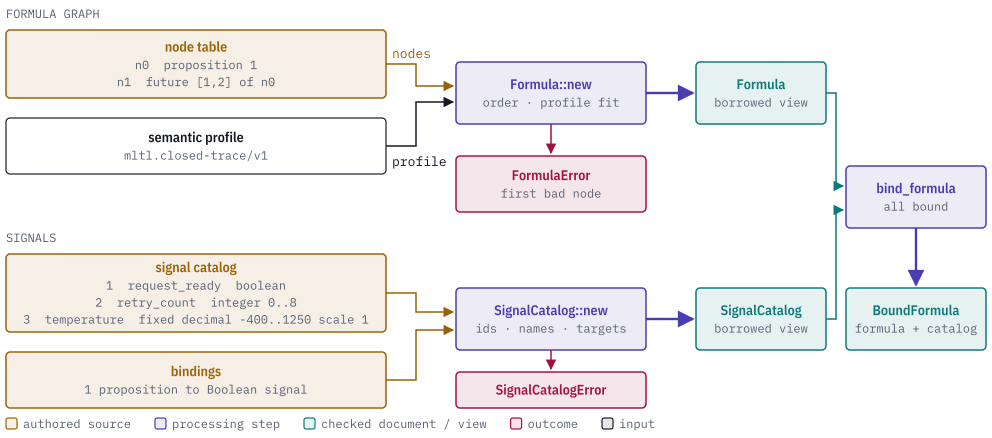
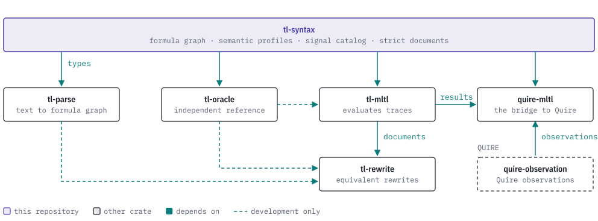

# tl-syntax

[](https://discord.gg/k8DVhuYBR2)
[](#license)
[](Cargo.toml)
[](docs/features.md)

tl-syntax is a Rust crate that defines the syntax tree, semantic profiles and
signal model for discrete bounded Mission-time Linear Temporal Logic (MLTL). It
is the base crate of the TL family:
[tl-parse](https://github.com/agent-ix/tl-parse),
[tl-rewrite](https://github.com/agent-ix/tl-rewrite),
[tl-mltl](https://github.com/agent-ix/tl-mltl),
[tl-oracle](https://github.com/agent-ix/tl-oracle) and
[quire-mltl](https://github.com/agent-ix/quire-mltl) all depend on it.

The crate validates formula graphs against a semantic profile, validates
catalogs of typed input signals and their bindings to propositions, and reads
and writes strict versioned JSON documents with a canonical form and a content
identity. It does not parse text and does not evaluate formulas. The default
build needs neither `std` nor an allocator.

<picture>
  <source media="(prefers-color-scheme: dark)" srcset="docs/images/hero-dark.svg">
  
</picture>

> **Status: prerelease.** The API is not stable. The crate has `publish = false`
> and other TL crates depend on it through git. Registry publication waits for
> the v0.1 assurance review.

## Usage

This builds a formula, binds it to a signal catalog and looks up the signal for a
proposition. It runs as a doc test with the default features.

```rust
use tl_syntax::{
    Formula, Interval, Node, NodeId, NodeKind, PropositionBinding, PropositionId,
    SemanticProfile, SignalCatalog, SignalDeclaration, SignalDomain, SignalId,
};

let nodes = [
    Node::new(NodeKind::Proposition { proposition: PropositionId(7) }),
    Node::new(NodeKind::Future {
        interval: Interval::new(1, 3).unwrap(),
        operand: NodeId(0),
    }),
];
let formula = Formula::new(SemanticProfile::ClosedTraceV1, NodeId(1), &nodes).unwrap();

let signals = [SignalDeclaration::new(SignalId(1), "request_ready", SignalDomain::Boolean)];
let bindings = [PropositionBinding::new(PropositionId(7), SignalId(1))];
let mut scratch = [0_u32; 1];
let catalog = SignalCatalog::new(&signals, &bindings, &mut scratch).unwrap();

let bound = catalog.bind_formula(formula).unwrap();
let signal = bound.signal_for_proposition(PropositionId(7)).unwrap();
assert_eq!(signal.name(), "request_ready");
```

The formula is `F[1,3] p7`. The same construction pattern is in
`tests/typed_signal_context.rs`. More examples, including JSON documents, are in
[docs/examples.md](docs/examples.md).

## Reference

| Module | What it holds |
| --- | --- |
| `formula::graph` | `Formula`, `Node`, `NodeKind`, `Interval`, `SourceSpan` and `FormulaError`. |
| `formula::profile` | `SemanticProfile`, `TemporalFamily` and the closed past-operator catalog. |
| `formula::document` | `FormulaDocument` for schemas `tl-syntax.formula/v1` and `v2` (feature `alloc`, strict readers with `serde`). |
| `formula::infinite` | The unbounded formula edition, `tl-syntax.formula-unbounded/v1`, and the infinite-trace profile. |
| `formula::trace` | Lasso traces, partial valuations and fairness premises (feature `alloc`). |
| `formula::liveness` | Routing of liveness requests to an optional backend (feature `alloc`). |
| `signal::{domain, catalog, binding}` | Boolean, integer and fixed-decimal signals, catalogs, and proposition bindings. |
| `signal::document` | Owned signal-catalog and proposition-map documents (feature `alloc`). |
| `contracts::{limits, manifest}` | Resource limits for readers, and the past-profile implementation manifest check. |
| `future` (crate root) | Lowering of derived operators `W` and `M` to primitive nodes, with typed refusals. |

| Feature | Default | Adds |
| --- | ---: | --- |
| none | yes | Borrowed formulas, signal catalogs, bindings and requirement contexts, with no allocation. |
| `alloc` | no | Owned documents. |
| `serde` | no | JSON serialization and strict readers, schema constants, content identity. Implies `alloc`. |

See [docs/api-reference.md](docs/api-reference.md) and
[docs/features.md](docs/features.md).

## The TL stack

tl-syntax holds the types every other TL crate shares. tl-parse reads text into
these graphs, tl-rewrite and tl-mltl work on them, tl-oracle is a development-only
reference evaluator, and quire-mltl is the one crate that connects the family to
Quire.

<picture>
  <source media="(prefers-color-scheme: dark)" srcset="docs/images/tl-stack-dark.svg">
  
</picture>

[docs/how-it-works.md](docs/how-it-works.md) shows where each crate sits in the
text-to-outcome pipeline.

## Building and testing

```sh
make test          # cargo test --all-features
make ci            # format, features, clippy, tests, corpus, conformance, deny, fuzz build, spec, MSRV, rustdoc
make check-corpus  # validate the corpus schemas and derived oracles
```

The Rust version is pinned in `rust-toolchain.toml` (1.98.1). Hosted CI is
manual-only; the checks run locally. Wire-decoder fuzzing is described in
[docs/wire-formats.md](docs/wire-formats.md).

## Contributing

Read [CONTRIBUTING.md](CONTRIBUTING.md) and [CLA.md](CLA.md). Work is specified
before it is implemented; see [CLAUDE.md](CLAUDE.md) for the workflow and
commands. The change history is in [CHANGELOG.md](CHANGELOG.md).

## License

Licensed under either of [Apache License, Version 2.0](LICENSE-APACHE) or the
[MIT license](LICENSE-MIT) at your option.
