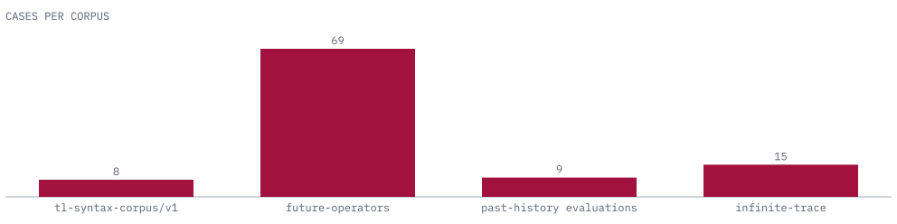

# Conformance corpus

The `corpus/` directory holds the checked-in data that the TL crates share. Each corpus is evidence input. It states expected results and does not evaluate anything itself. Downstream crates read it in place through `tl_syntax::CORPUS_DIR` and do not copy it.

<picture>
  <source media="(prefers-color-scheme: dark)" srcset="images/corpus-dark.svg">
  
</picture>

The chart counts fixtures for the shared corpus, cases for the future-operator and infinite-trace corpora, and evaluations for the past-history corpus. Counts come from the corpus files.

## The corpora

| Corpus | Identifier | Contents | Replayed by |
| --- | --- | --- | --- |
| Shared temporal corpus | `tl-syntax-corpus/v1` | Formula-v1 fixtures with a trace, an expected horizon and an expected closed-trace result; malformed inputs with an expected refusal. | `examples/corpus_gate.rs`, `examples/corpus_conformance.rs` |
| Future operators | `tl-syntax.future-operator-corpus/v1` | Source text for derived `W` and `M` paired with canonical graphs: derived, primitive, direct, refused and malformed cases. | `tests/future_operator_corpus.rs` |
| Past history | `tl-syntax.past-history-corpus/v1` | Formula-v2 graphs for `O`, `H`, `Y`, `S`, `T`, origin-complete histories, anchored outcomes, rewrite expectations, refusals and external-target dispositions. | `tests/past_history_corpus.rs` |
| Infinite trace | `tl-syntax.infinite-trace-corpus/v1` | Unbounded formula, lasso trace and fairness premises with an expected settlement or a typed refusal, and a written derivation. | `tests/infinite_trace_corpus.rs` |

## The shared corpus

`corpus/manifest.json` indexes it. Its fixtures:

| Class | Fixtures | Expected |
| --- | --- | --- |
| `primitive`, `nested`, `boundary`, `short-trace`, `large-bound` | 5 | Valid. Each lists a trace, `expected_horizon` and `expected_closed_trace`. |
| `malformed` | 3 | Invalid, with `interval_inverted`, `operand_not_preceding` or `unsupported_semantic_profile`. |

A trace is an array of instants, and each instant lists the proposition identities that are true. `expected_horizon` is the formula's maximum look-ahead from the current instant. The largest fixture has a horizon of 4,294,967,295. Fixture identities, paths, traces and expected values are stable in v1.

Formula files follow `corpus/schema/formula-v1.schema.json` and proposition names follow `proposition-map-v1.schema.json`. The malformed files break either interval decoding or graph validation on purpose. They are not examples of accepted documents.

## Replaying it

```sh
make check-corpus   # corpus_gate and its tests
make conformance    # corpus_conformance
```

`corpus_gate` validates every file against its schema, checks the semantic rules a Draft 7 schema cannot express (interval and span order, root range, operands that precede their node), and independently derives each horizon and closed-trace result from the formula, trace and declared semantics. The gate's own tests flip one expected result and require the gate to reject the corpus.

`corpus_conformance` decodes each fixture with the crate's own types and checks that accepted fixtures are accepted and rejected ones fail for the declared reason. It identifies the reason by matching the typed error, never its message. It prints one JSON object per fixture and exits 0 when all match, 1 when one does not, and 2 when it could not run. It computes no horizons or verdicts; evaluation belongs to tl-mltl.

## Using the corpus from another crate

```rust
let root = std::path::Path::new(tl_syntax::CORPUS_DIR).join("past-history");
let manifest = std::fs::read(root.join("manifest.json")).unwrap();
```

`CORPUS_DIR` is resolved when tl-syntax compiles. A git or path dependency carries the full repository tree, so the path exists in the dependent's build.

## External targets

The past-history corpus records a disposition for four external targets and runs none of them: FRET is supported for output only, R2U2 and C2PO are unavailable until an exact past-profile correspondence is reviewed, and Isabelle/HOL is unsupported because its reviewed oracle is future-only.
