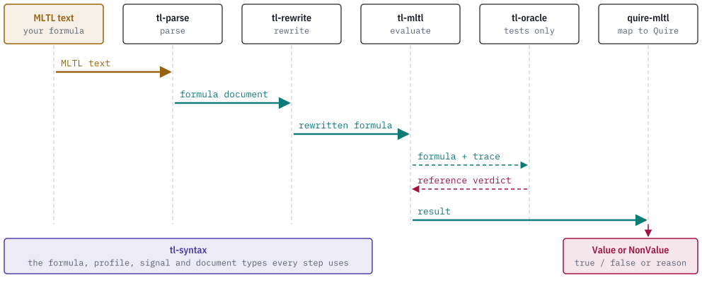

# How it works

## The formula graph

A formula is a table of nodes. Each node is a `Node` that holds a `NodeKind` and an optional `SourceSpan`. Operands are indices into the same table, and every operand must point to an earlier node. A formula names one root node. `Formula::new(profile, root, &nodes)` checks the table and returns a `Formula`, a copyable borrowed view that owns nothing.

`Formula::new` refuses a table when:

- the root is outside the table (`RootOutOfRange`),
- the table has more nodes than a 32-bit identity can address (`TooManyNodes`),
- an operand is the node itself, a later node or absent (`OperandNotPreceding`),
- a temporal node does not belong to the profile (`ProfileIncompatibleNode`).

`NodeKind` has 17 variants: `False`, `True`, `Proposition`, `Not`, `And`, `Or`, `Implies`, `Equivalent`, the future operators `Future`, `Globally`, `Until`, `Release`, and the past operators `Once`, `Historically`, `StrongPrevious`, `Since`, `Triggered`. Temporal nodes carry an inclusive `Interval` of unsigned 32-bit instants. `Interval::new(start, end)` rejects `start > end`.

Propositions are numeric `PropositionId`s. The crate does not store their names; a proposition-map document does that.

## Semantic profiles

A `SemanticProfile` states which temporal direction a formula may use.

| Profile | Wire identifier | Admits |
| --- | --- | --- |
| `ClosedTraceV1` | `mltl.closed-trace/v1` | Future operators. Boolean semantics over a complete finite trace. |
| `OnlinePrefixV1` | `mltl.online-prefix/v1` | Future operators. A result stays pending until the prefix decides it. |
| `OriginCompleteHistoryV1` | `mltl.origin-complete-history/v1` | Past operators over a discrete position history. |
| `InfiniteTraceV1` | `mltl.infinite-trace/v1` | Future and past operators over an infinite trace. |

Boolean nodes are admitted by every profile. `SemanticProfile::ALL` lists the four, and `as_str` gives the identifier.

The crate checks that a node is admitted by the profile. It does not give the nodes a meaning; tl-mltl and tl-oracle do that.

## Signals and bindings

A signal is a named input to the monitored system. A `SignalDeclaration` has a `SignalId`, a name and a `SignalDomain`: `Boolean`, a bounded `Integer`, or a bounded `FixedDecimal` (coefficient bounds and a scale from 0 to 18). `SignalCatalog::new(signals, bindings, scratch)` validates a catalog with these rules:

- signal identities strictly increase,
- names are not empty, are at most 255 bytes, and are unique,
- binding propositions strictly increase,
- each binding targets a declared signal, and that signal is Boolean.

The `scratch` slice is caller-provided memory for the name-uniqueness check, which is how the borrowed catalog avoids allocating. It needs one `u32` per signal.

`catalog.bind_formula(formula)` checks that every proposition node in the formula has a binding and returns a `BoundFormula`. Numeric signals are valid catalog entries but cannot bind directly to a proposition. Turning a numeric signal into a Boolean is the job of a predicate layer outside this crate.

A `RequirementContext` carries four caller-supplied strings (requirement id, revision, clause id, anchor, each at most 1,024 bytes) and a source span. The crate checks that they are present and bounded and does not check that they are true.

## Documents

With the `alloc` feature, `FormulaDocument`, `PropositionMapDocument`, `SignalCatalogDocument` and `RequirementContextDocument` own their data. With `serde`, they have JSON schemas, strict byte readers, a canonical encoding and a content identity. [wire-formats.md](wire-formats.md) describes the formats.

Formula documents come in three editions:

- `tl-syntax.formula/v1` carries future operators only.
- `tl-syntax.formula/v2` adds the past operators. A v1 document upgrades to v2 without loss. A v2 document converts back only when it uses no past profile and no past node.
- `tl-syntax.formula-unbounded/v1` carries the infinite-trace profile, where an interval may be open at the top, written `[a,)`.

## Derived future operators

Weak until `W` and strong release `M` are not nodes. A `FutureLoweringRequest` describes one use of either operator with raw, unchecked fields. `lower()` checks them in a fixed order and returns three canonical nodes: `p W[a,b] q` becomes `(p U[a,b] q) | G[a,b] p`, and `p M[a,b] q` becomes `(p R[a,b] q) & F[a,b] p`. A bad request returns the single highest-priority `FutureLoweringRefusal` with a stable code. Lowering does not allocate.

## Where the crate sits

A formula passes through several crates on its way from text to a Quire outcome. All of them exchange the documents and types defined here.

<picture>
  <source media="(prefers-color-scheme: dark)" srcset="images/pipeline-dark.svg">
  
</picture>

The calling program moves documents from one stage to the next. The dependency structure between the crates is in the [README](../README.md#the-tl-stack).
