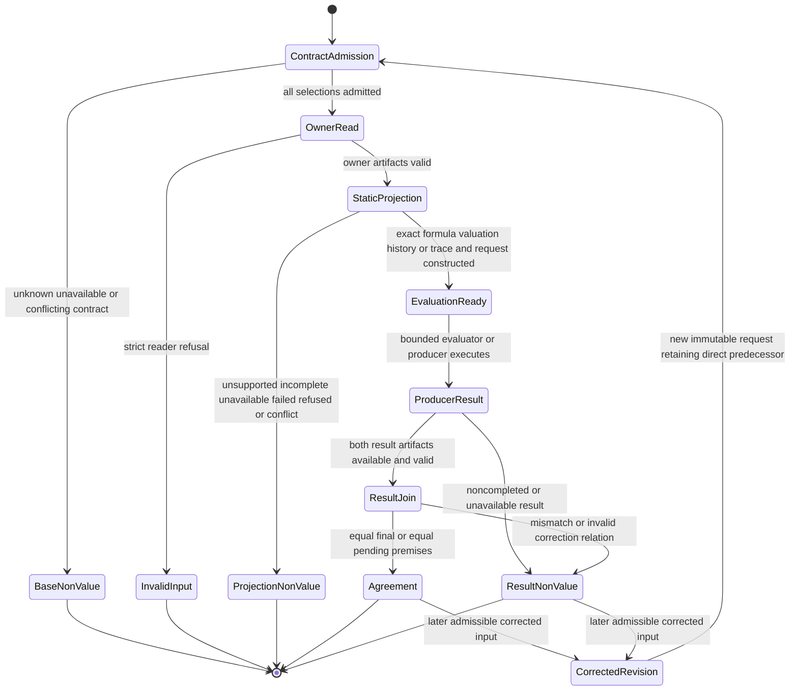

# [SM-001] Temporal assessment artifact lifecycle

## States

These are the named states in the lifecycle diagram below.

| State | Description |
|---|---|
| ContractAdmission | Selected contracts are admitted before their governed bytes are interpreted. |
| BaseNonValue | Contract admission has no usable value. |
| OwnerRead | Selected owner artifacts are read. |
| InvalidInput | An owner strict reader refused its input. |
| StaticProjection | Owner artifacts are projected into temporal inputs. |
| ProjectionNonValue | Static projection has no usable value. |
| EvaluationReady | The exact formula, valuation, history or trace, and request are constructed. |
| ProducerResult | The bounded evaluator or producer executes. |
| ResultNonValue | A producer or result join has no usable value. |
| ResultJoin | Both available, valid result artifacts are joined. |
| Agreement | Final results or pending premises agree. |
| CorrectedRevision | Later admissible corrected input starts a new immutable request. |

## Transitions

The Trigger cells transcribe the diagram's edge labels. Blank cells mean the
diagram declares no label, guard, or emitted artifact for that edge.

| From | To | Trigger | Guard | Emits |
|---|---|---|---|---|
| ContractAdmission | BaseNonValue | unknown unavailable or conflicting contract | | |
| ContractAdmission | OwnerRead | all selections admitted | | |
| OwnerRead | InvalidInput | strict reader refusal | | |
| OwnerRead | StaticProjection | owner artifacts valid | | |
| StaticProjection | ProjectionNonValue | unsupported incomplete unavailable failed refused or conflict | | |
| StaticProjection | EvaluationReady | exact formula valuation history or trace and request constructed | | |
| EvaluationReady | ProducerResult | bounded evaluator or producer executes | | |
| ProducerResult | ResultNonValue | noncompleted or unavailable result | | |
| ProducerResult | ResultJoin | both result artifacts available and valid | | |
| ResultJoin | Agreement | equal final or equal pending premises | | |
| ResultJoin | ResultNonValue | mismatch or invalid correction relation | | |
| Agreement | CorrectedRevision | later admissible corrected input | | |
| ResultNonValue | CorrectedRevision | later admissible corrected input | | |
| CorrectedRevision | ContractAdmission | new immutable request retaining direct predecessor | | |

## Lifecycle diagram

Every terminal transition returns one complete operation-specific decision or
one operation diagnostic and no usable partial artifact. A correction starts a
new immutable revision; it never mutates or reclassifies the predecessor in
place. Contract admission always precedes interpretation of bytes governed by
that contract.
